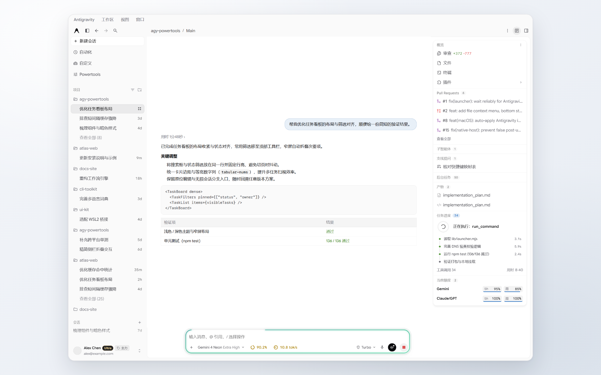
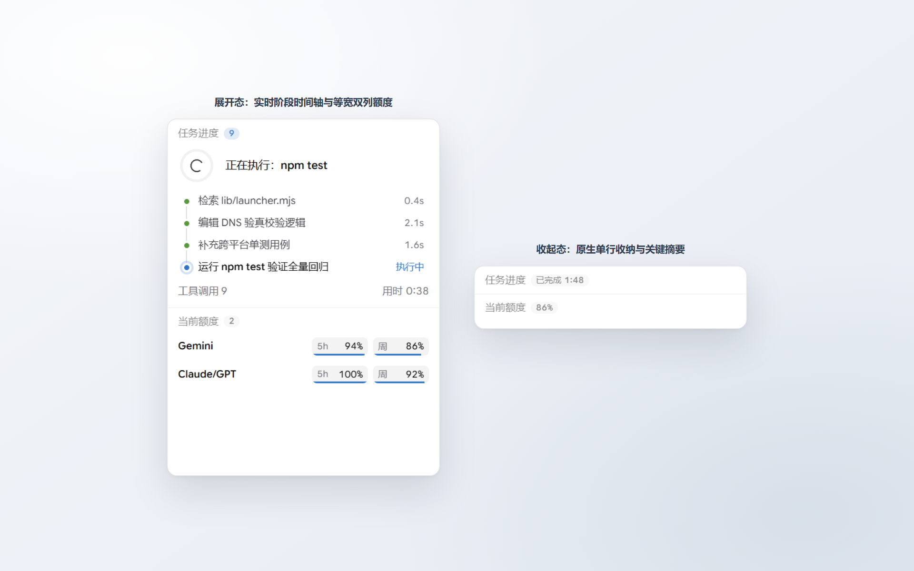
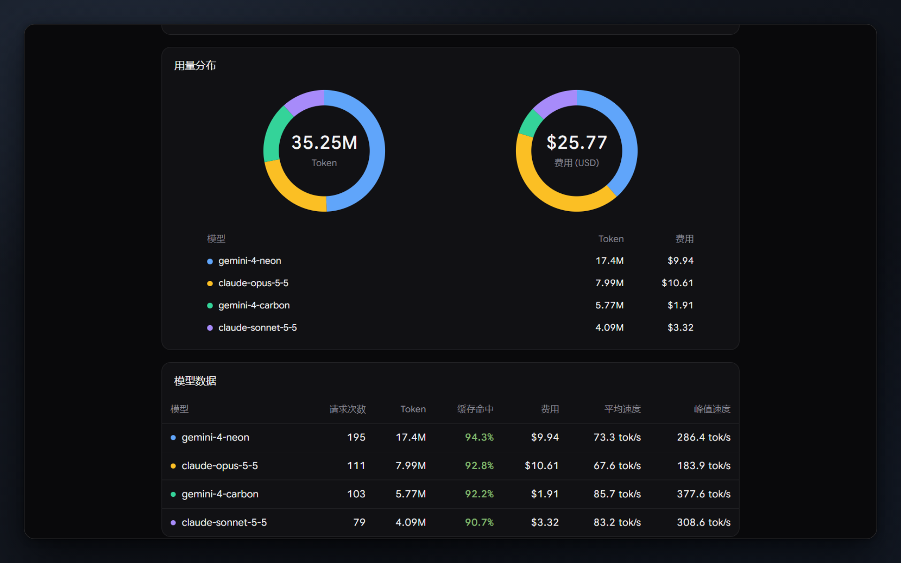
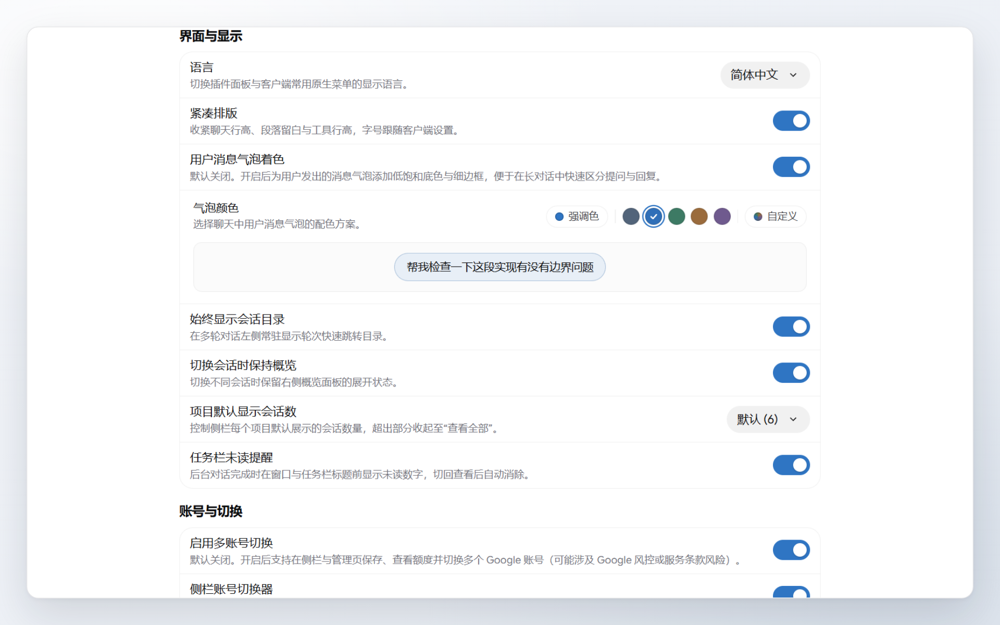
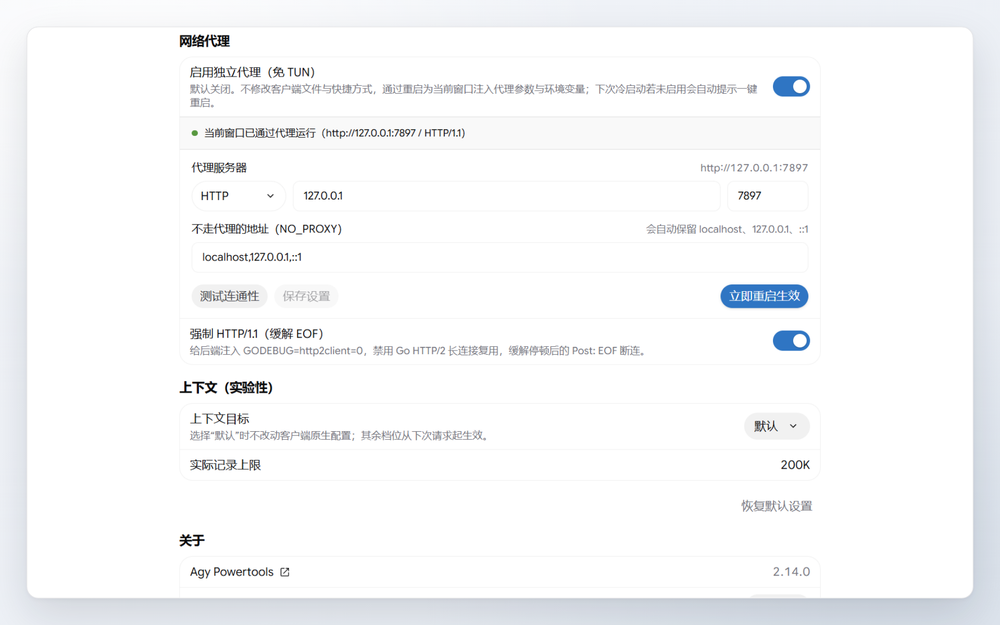

<div align="center">
  
  <h1>Agy Powertools</h1>
  <p><strong>Antigravity 2.0 零补丁原生增强插件</strong></p>
  <p>实时遥测、额度光环、无损会话分支、多账号切换、免 TUN 代理与 WSL2 / SSH 远程支持</p>
  <!-- plugin-badges:start -->
  <p>
    <a href="https://github.com/WhiteBr1ck/agy-powertools/releases"></a>
    <a href="https://github.com/WhiteBr1ck/agy-powertools/actions/workflows/ci.yml"></a>
    <a href="LICENSE"></a>
    
    = 22.13" />
    
  </p>
  <!-- plugin-badges:end -->
  <p>
    <strong>简体中文</strong> |
    <a href="README_EN.md">English</a>
  </p>
  <p>
    <a href="#功能画廊">功能画廊</a> |
    <a href="#核心能力">核心能力</a> |
    <a href="#快速安装">快速安装</a> |
    <a href="#配置参考">配置参考</a> |
    <a href="#更新日志">更新日志</a>
  </p>
</div>

<p align="center">
  
</p>

> **Agy Powertools** 通过本机调试接口直接挂载在 Antigravity 2.0 客户端内部，只读解析本地 SQLite 与 JSONL 会话记录。**不修改 `app.asar`、不打开外部网页、零外部数据外传**，所有增强控件均以客户端原生组件风格无缝融入界面。

---

## 功能画廊

<table>
  <tr>
    <th width="50%">输入框额度光环、上下文拆解与速度码表</th>
    <th width="50%">可折叠任务进度、当前额度与文件右键菜单</th>
  </tr>
  <tr>
    <td>
      
      <p>顺时针仪表语义额度光环（青绿 / 琥珀 / 红），支持自动、周限额、5h 周期切换；独立上下文圆环（含 Orchestrator 分模型）与动态指针速度码表。</p>
    </td>
    <td>
      
      <p>对齐原生样式的折叠收纳区（实时阶段时间轴 + 等宽双列额度），支持消息与文件树右键引用、打开与局域网 NAS / SMB 路径及用户气泡着色。</p>
    </td>
  </tr>
  <tr>
    <th>用量概览（浅色主题：热力图与模型健康）</th>
    <th>用量概览（深色主题：双圆环与模型统计）</th>
  </tr>
  <tr>
    <td>
      
      <p>默认按原生周重置周期对齐「本轮周限额内用量」，汇总请求数、输入输出 Token、整体缓存命中率、参考费用、53 周热力图与模型健康时间线。</p>
    </td>
    <td>
      
      <p>完整跟随客户端浅 / 深双主题，以双圆环直观对比各模型 Token 与参考费用占比，并在模型数据表中按语义着色展示缓存命中率与吞吐速度。</p>
    </td>
  </tr>
  <tr>
    <th>请求事件与短间隔缓存异常检测</th>
    <th>多账号切换与额度管理（默认关闭）</th>
  </tr>
  <tr>
    <td>
      
      <p>支持按账号、模型、会话与结果筛选单次请求；自动识别同会话短间隔缓存清空与骤降并标红提示，排除冷启动、切模型与上下文压缩误报。</p>
    </td>
    <td>
      
      <p>基于系统原生凭据库本地隔离多个 Google 账号（不落明文），支持侧栏快捷切换、列表/卡片双视图、拖动排序、凭据校验与耗尽自动切号。</p>
    </td>
  </tr>
  <tr>
    <th>多语言界面、气泡着色与光环设置</th>
    <th>免 TUN 独立代理与 Markdown 更新说明</th>
  </tr>
  <tr>
    <td>
      
      <p>支持简体中文 / 繁體中文 / English 无闪烁切换（覆盖原生菜单与 Swarm 面板）；内置低饱和用户气泡着色预览、概览额度与光环周期配置。</p>
    </td>
    <td>
      
      <p>不改安装文件与快捷方式的独立代理注入，内置 HTTP CONNECT / SOCKS5 连通性测试与强制 HTTP/1.1；应用内校验更新支持原生 Markdown 日志渲染。</p>
    </td>
  </tr>
</table>

---

## 核心能力

### 效率与会话体验
- **类 Codex 对话节奏**：保留客户端字号并收紧行高与块间距（紧凑排版约节省 19% 纵高）；执行多步工具时实时汇报阶段进展，整轮结束后自动折叠进顶部用时栏，正文只留结论。
- **无损会话分支与原位消息编辑**：从任意历史回答或会话菜单调用原生 `ForkConversation` 一键分叉（自动处理含子智能体会话并按 `(1)` / `(2)` 重命名）；点击已发消息旁编辑按钮直接在原位置挂载原生富文本输入框重发。
- **文件右键菜单（含局域网 NAS / SMB）**：右键消息中的 `file://` 链接或右侧文件树，支持「引用到输入框」「用默认应用打开」「打开所在文件夹」「复制文件」「复制路径」；Windows 下通过 DNS 验真非公网 IP 原生兼容局域网 NAS 与 `wsl.localhost`（仍拦截公网 SMB 防凭据外泄）。
- **多语言原生本地化**：简体中文 / 繁體中文 / English 首屏介入无闪烁，覆盖侧栏、菜单、权限审批弹窗、模型说明、设置页及 Swarm 讨论板 iframe，严格保护对话正文与代码块。

### 遥测、额度与看板
- **输入框遥测与顺时针额度光环**：独立「上下文圆环」（含缓存复用、压缩次数与 Orchestrator 规划/执行双模型拆解）、「动态速度码表」（`tok/s`、TTFT、模型/工具耗时与本会话参考费用），以及可选的输入框外框额度光环（支持自动 / 周限额 / 5h 切换）。
- **右侧原生折叠概览**：将「任务进度」（实时阶段、连接线时间轴、单步耗时、每秒计时）与可选「当前额度」（5h / 周等宽胶囊）做成对齐原生的可折叠区块，折叠后仍保留状态与最低额度摘要。
- **Powertools 本地分析看板**：涵盖概览（默认本轮周限额内用量）、请求事件（含短间隔缓存异常标红）、错误事件（一键复制）、额度（含多设备增量快照校准）与官方参考单价刷新，完整支持子智能体（Subagent）合并统计。

### 跨环境与高阶工具
- **Windows Antigravity + WSL2 后端模式**：自动识别 WSL2 并定位 Windows `DevToolsActivePort`，兼容 Mirrored 直连与默认 NAT 模式（内置持久化 TCP-over-stdio 桥接），支持 WSL2 混合多账号凭据库（双文件 `0600` + Windows 凭据管理器隔离备份）与自动重启委托。
- **OpenSSH 远程窗口零落盘统计**：在 `SSH: ...` 远程窗口中复用本地 OpenSSH 配置运行内存只读通道，同步展示远端会话、子智能体与看板统计，无需在远端安装插件或常驻后台。
- **多账号切换与免 TUN 独立代理（均默认关闭）**：多账号基于操作系统原生凭据库（Windows 凭据管理器 / macOS 钥匙串 / Linux Secret Service）；独立代理支持三段输入、连通性测试、`GODEBUG=http2client=0` 缓解 `EOF` 与冷启动提醒。

---

## 快速安装

> 环境要求：已安装并至少启动过一次 Antigravity；优先使用本机 Node.js `>= 22.13`，未安装时自动回退客户端自带的 `agy-node`，无需 `npm install` 或管理员权限。

### 方式一：发给 Agent 自动安装（推荐）

直接把下面这段提示词发给 Antigravity 或任意可执行本地命令的 Agent：

> 请帮我安装 Agy Powertools：https://github.com/WhiteBr1ck/agy-powertools 。先阅读 README 和 docs/INSTALL_AGENT.md，使用项目提供的统一安装器，优先使用已有 Node.js 或 Antigravity 自带运行环境。保留其他插件、账户设置和聊天记录，不要强制退出当前客户端。安装后核对版本并告诉我结果；需要重启时最后提醒我。

详见 [Agent 安装指南](docs/INSTALL_AGENT.md)。

### 方式二：命令行一键安装

从 [Releases](https://github.com/WhiteBr1ck/agy-powertools/releases) 下载最新 ZIP 解压（或克隆本仓库），在项目目录运行：

```powershell
# Windows (PowerShell)
powershell -NoProfile -ExecutionPolicy Bypass -File .\install.ps1
```

```sh
# macOS / Linux / WSL2
sh ./install.sh
```

覆盖安装会自动保留已有设置，不会强制关闭客户端；完成手头任务后重启 Antigravity，左侧栏出现 **Powertools** 即生效。macOS 会自动在 `~/Applications/` 生成带原版图标的启动器，拖入 Dock 替代原图标即可。

### 应用内更新与卸载

- **应用内更新**：进入 **Powertools -> 设置 -> 关于 -> 检查更新**，点击 **立即更新** 自动完成 SHA-256 校验、备份与健康检查，异常自动回滚。
- **彻底卸载**：运行 `powershell -NoProfile -ExecutionPolicy Bypass -File .\uninstall.ps1`（Windows）或 `sh ./uninstall.sh`（macOS / Linux / WSL2）；末尾加 `--keep-settings` 可保留个人偏好配置。不影响原生聊天记录、账号与其他插件。

---

## 配置参考

所有选项均可在 **Powertools -> 设置** 中实时开关并持久化（底部支持一键恢复默认）。

<details>
<summary><strong>展开查看全部设置项、环境变量与数据目录</strong></summary>

### 界面与显示

| 配置项 | 默认值 | 说明 |
| --- | --- | --- |
| 启用 Powertools | 开启 | 全局总开关；关闭后立即暂停所有注入与增强，保留已保存配置 |
| 语言 | `简体中文` | 可选 `简体中文` / `繁體中文` / `English`，作用于插件与原生界面 |
| 紧凑排版 | 开启 | 收紧行高至 `1.4`、段落间距与工具行高，保留客户端设定字号 |
| 用户消息气泡着色 | 关闭 | 为用户气泡添加低饱和底色与细边框，支持强调色、5 套预设与自定义色 |
| 始终显示会话目录 | 开启 | 在多轮对话左侧常驻显示轮次快速跳转目录 |
| 切换会话时保持概览 | 开启 | 切换会话时保留右侧概览面板的展开状态 |
| 项目默认显示会话数 | `默认 (6)` | 控制侧栏每个项目默认展示条数（`默认 (6)` / `1–10` / `全部展开`） |
| 任务栏未读提醒 | 开启 | 后台对话完成时在窗口与任务栏标题前显示 `(N)` 未读数，切回自动消除 |

### 统计与进度

| 配置项 | 默认值 | 说明 |
| --- | --- | --- |
| 概览默认时间范围 | `本轮周限额内用量` | 可选本轮周限额内用量、今天、24 小时、昨天、本周、本月、30 天或全部时间 |
| 上下文圆环 | 开启 | 在输入框模型选择器旁显示上下文占用圆环、缓存复用与 Orchestrator 拆解 |
| 速度与统计 | 开启 | 显示动态指针码表与实时速率，点击查看会话统计与参考费用 |
| 任务进度 | 开启 | 在右侧概览显示原生折叠式任务清单、实时阶段与连接线活动时间轴 |
| 概览显示账号额度 | 关闭 | 在右侧概览底部以可折叠等宽双列胶囊展示 5 小时与周剩余额度 |
| 输入框额度光环 | 关闭 | 沿输入框外框顺时针绘制当前模型剩余额度（青绿 / 琥珀 / 红） |
| 光环额度周期 | `自动（较低项）` | 开启光环后可选 `自动（较低项）` / `周限额` / `5 小时限额` |
| 子智能体上下文与统计 | 开启 | 在概览子智能体行、子智能体输入框与主会话浮窗展示子智能体遥测 |
| 每轮用时 / 点击展开工具 | 开启 | 在已完成回复顶部显示总耗时，点击展开工具调用与阶段汇报详情 |

### 会话增强、账号、代理与实验性上下文

| 配置项 | 默认值 | 说明 |
| --- | --- | --- |
| 阶段汇报 | 开启 | 类 Codex 实时汇报工作进展，整轮完成后自动折叠过程 |
| 并行检索与读取 | 关闭 | 引导 Agent 在同一轮合并搜索与读取相关文件，减少来回轮次 |
| 分支会话 / 消息编辑 / 文件右键 | 开启 | 无损会话分叉、原位原生富文本编辑与本地 / NAS / 文件树右键操作 |
| 启用多账号切换 | 关闭 | 需确认风险提示；含侧栏切换器、列表/卡片视图、5H/周周期与耗尽自动切号 |
| 启用独立代理（免 TUN） | 关闭 | 协议 / 主机 / 端口三段配置、连通性测试、冷启动提醒与可选强制 HTTP/1.1 |
| 上下文目标（实验性） | `默认` | 可选 `默认` / `256K` / `500K` / `1M`；`默认` 完全不改动原生配置 |

### 环境变量与文件路径

| 名称 / 路径 | 说明 |
| --- | --- |
| `ANTIGRAVITY_USER_DATA_DIR` | 使用独立客户端配置目录时指定自定义用户数据目录 |
| `ANTIGRAVITY_CDP_PORT_FILE` | 显式指定 `DevToolsActivePort` 绝对路径（亦兼容 `AGY_BROWSER_ACTIVE_PORT_FILE`） |
| `~/.gemini/config/plugins/agy-powertools/` | 插件程序与运行脚本安装目录 |
| `~/.gemini/antigravity/plugin_data/agy-powertools/` | 个人设置、账号元数据、采样与官方参考单价缓存目录 |

</details>

---

## 更新日志

### v2.14.0
- **原生支持 Windows Antigravity + WSL2 后端模式（#21，感谢 `@Hopeless` 的完整方案设计与真机测试）**：
  - **WSL2 识别与零配置 CDP 接入**：自动识别 WSL2 并定位 Windows 侧 `%APPDATA%\Antigravity\DevToolsActivePort`；优先直连 `127.0.0.1`（兼容 Mirrored 模式），默认 NAT 网络下自动通过 WSL Interop 拉起持久化 Windows `node.exe` / `agy-node.exe` 多路复用 TCP-over-stdio 桥接（组件发现自动走页面上下文 `fallbackFetch`），无需修改 `.wslconfig` 或改动 TUN 路由。
  - **WSL2 混合多账号凭据库与运行期能力探测**：新增 `vault.probe()` 并透出真实报错原因；WSL2 下活跃态原子 `0600` 成对读写 `~/.gemini/jetski-standalone-oauth-token` 与 `~/.config/antigravity/credential-user-scope`，备份槽位经 `stdin` + `WSLENV` 存入 Windows 凭据管理器并按 `agy-powertools:wsl:<distro>:account:<id>` 隔离。
  - **快捷方式、重启委托与优雅降级**：WSL2 下委托 Windows `powershell.exe` 维护 `.lnk` 与重启 `Antigravity.exe`；切号后自动重启失败返回 `manualRestartRequired` 提示手动重启；安装器补充 `nvm` 非登录 Shell 检测提示，sidecar 启动自动回收失活 PID 运行态文件。

### v2.13.9
- **文件右键菜单支持 Windows 局域网 NAS / SMB 共享路径（UNC）**：按 RFC 8089 兼容 2/4 斜杠 UNC URI，触碰 SMB 前通过字面量 IP 与系统 `dns.lookup` 核验所有解析结果均属于 IANA 非公网路由地址（覆盖局域网 IP、NetBIOS 短名、内网域名、Tailscale / VPN 私网与 `*.localhost` / `wsl$`），无需硬编码域名后缀表，继续拦截公网主机防 NTLM 凭据外泄；修复含空格 UNC 路径在 `explorer.exe /select` 下的定位。

### v2.13.8
- **修复输入框额度光环在新建会话页框选过多的问题**：改为直接挂载在 `.surface-composer-card` 输入卡片本体，不再把上方项目/分支栏套进光环。
- **新增「光环额度周期」选项**：支持在 `自动（较低项）`、`周限额` 与 `5 小时限额` 间自由切换。
- **修复检查更新的更新说明 Markdown 渲染**：将「设置 -> 关于 -> 更新说明」升级为纯 React 安全 Markdown 渲染，支持标题、嵌套列表、加粗、行内代码、分割线与 `https://` 外链。

### v2.13.7
- **新增「输入框额度光环」与「概览显示账号额度」（#18，默认关闭）**：顺时针仪表语义额度光环（`>=50%` 青绿、`20%-49%` 琥珀、`<20%` 常亮红）；右侧「任务进度」与「当前额度」均升级为对齐原生样式的折叠收纳区与等宽双列胶囊。
- **多设备周限额估算增量校准（#19）**：记录同周期增量快照点，自动剔除无本机请求的跨设备消耗段，修复 Mac / Windows 多设备混用时周额度估算偏低问题。
- **消除火绒 / 杀软误报并停用冗余钩子子进程（#20）**：移除 Windows 隐藏 PowerShell `FlashWindowEx` 任务栏闪烁调用，任务栏未读提醒改为纯前端标题数字 `(N)`，停用遗留 `hooks.json` 钩子。
- **补全高频原生界面翻译**：补齐侧栏项目右键菜单、权限审批弹窗选项与动态规则模板以及 `Thought Process`、`Thought for Xs`、`Step X of Y`（简繁同步生效）。

<details>
<summary>查看早期版本历史（v2.10.0 - v2.13.6）</summary>

- **v2.13.6**：精简右侧「任务进度」面板（合并实时阶段、连接线时间轴、单步耗时与右对齐每秒计时），补全 Orchestrator 提示翻译。
- **v2.13.5**：新增可选「用户消息气泡着色」（强调色 / 5 套预设 / 自定义与居中预览），优化请求事件列宽，修复含 `#` 路径的 `file://` 右键菜单，补全 Antigravity 2.34.0 界面与弹窗翻译。
- **v2.13.4**：概览新增并默认使用「本轮周限额内用量」（#12），支持 OpenSSH 远程窗口统计（#14），多账号额度隔离与按账号筛选请求（#9、#11），文件右键支持引用图片与文件到输入框，Swarm 面板多语言本地化（#10），修复 `/btw` 与分屏遥测及瞬时超时误报（#15）。
- **v2.13.3**：支持含子智能体会话的完整无损分支，macOS 启动器自动复用原版图标与 Dock 替换指引（#7、#8），补全 2.34.0 菜单与弹窗翻译。
- **v2.13.2**：概览与请求页新增缓存命中率与短间隔缓存异常标红（#6），新增繁體中文（`zh-TW`），适配 2.34.0 Orchestrator 与动态 Claude 定价解析。
- **v2.13.1**：新增子智能体（Subagent）上下文与统计显示、任务进度实时阶段提示、概览「今天」范围与官方辅助面板内置备用更新通道。
- **v2.13.0**：适配 Antigravity 2.34.0，新增多账号切换与免 TUN 应用级独立代理，修复原位编辑切会话丢失与已安装插件页徽章变形（#5）。
- **v2.12.0 - v2.12.10**：先后引入应用内校验更新、客户端组件缓存、原位原生富文本消息编辑、任务栏未读提醒、上下文/速度双浮窗、本地文件右键菜单（#2）、侧栏项目默认会话数与多窗格健康检查修复（#1、#3、#4）。
- **v2.10.0 - v2.11.0**：适配 Antigravity 2.32.x 渲染器，重绘 Token / 费用双圆环与全局总开关。

</details>

---

## 协议与链接

- **开源协议**：[MIT License](LICENSE)（自定义日期范围日历交互改编自 HextaUI，基于 `react-day-picker` 与 `date-fns`，许可见 [lib/vendor/NOTICE.txt](lib/vendor/NOTICE.txt)）
- **问题反馈**：[GitHub Issues](https://github.com/WhiteBr1ck/agy-powertools/issues)（提交时请附操作系统、Antigravity 版本与插件版本）
- **友情链接**：[LINUX DO](https://linux.do/) - 新的理想型社区
