# Agy Powertools

为 Antigravity 2.0 补齐原生界面汉化、类 Codex 会话体验、上下文与缓存监控、会话分支及本地用量面板。

插件在原生界面内提供紧凑排版、阶段汇报与完成后自动折叠、从任意回答创建分支、消息编辑重发、任务进度和用量统计。通过本机调试接口接入客户端，只读读取本地 SQLite 与 JSONL 记录，不修改客户端程序文件。

当前版本 **2.12.1**，适配 Antigravity **2.32.1**。Windows 已验证安装与卸载；macOS 和 Linux 已提供路径适配与安装脚本，尚未实机验证。

[类 Codex 会话体验](#类-codex-会话体验) | [功能](#功能) | [安装](#安装) | [界面预览](#界面预览) | [更新与卸载](#更新与卸载) | [数据与隐私](#数据与隐私) | [常见问题](#常见问题)

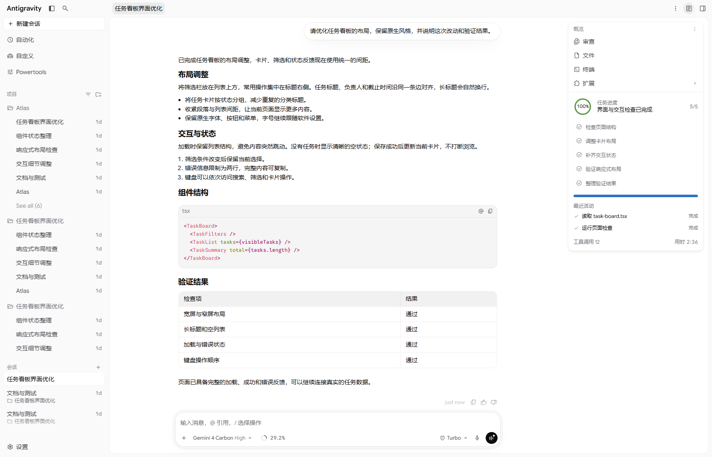

## 类 Codex 会话体验

Antigravity 默认聊天界面留白较多，执行多步任务时也缺少边做边汇报、做完自动收起的节奏。Agy Powertools 默认开启 **紧凑排版** 与 **阶段汇报**，提供接近 Codex 的对话体验：

- **阶段汇报（工作时说明进展，完成后自动折叠过程）**：模型在调用工具期间，会在关键步骤前简短说明当前进展和下一步动作；整轮任务完成后，中间的阶段说明会随工具记录一起自动收进顶部的用时折叠栏，聊天区只保留最终回答。需要回看细节时，点击该轮用时即可重新展开。
- **紧凑视图（同字号高密度排版）**：字号跟随 Antigravity 自身设置不变，通过收紧正文行高、段落与分割线间距，并压缩工具组和工具记录行高，在一屏内展示更多代码、工具状态与对话内容。

下图两侧使用同一段内容、相同窗口宽度与 14px 字号，仅切换紧凑排版。此示例正文高度减少约 19%，具体幅度随内容变化：

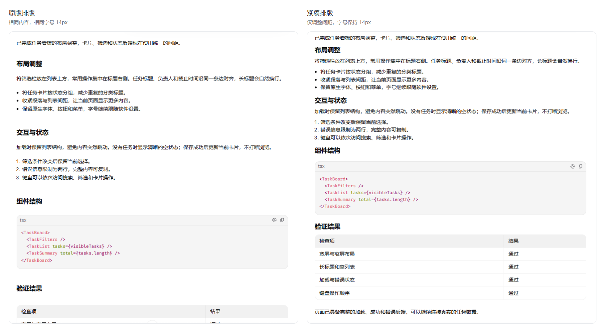

## 功能

### 会话与交互

| 功能 | 入口位置 | 说明 |
| --- | --- | --- |
| 上下文与会话统计 | 输入框模型选择器旁圆环 | 查看上下文占比与分类、缓存命中率、平均与峰值速度、模型与工具用时 |
| 阶段汇报 | 聊天消息区 | 工作时实时说明当前进展，完成后自动折叠中间过程，只保留最终回答 |
| 会话分支 | 回答操作栏 / 会话菜单 | 从某条历史回答另开聊天继续，或通过会话菜单 `分支会话` 继承完整历史 |
| 消息编辑 | 已发送消息操作栏 | 修改已发送的消息，从该处重新生成后续回答 |
| 任务进度与目录 | 右侧概览 / 会话左侧 | 查看任务清单进度、最近工具活动与本轮用时；支持常驻会话轮次目录 |

### 界面与显示

| 功能 | 入口位置 | 说明 |
| --- | --- | --- |
| 紧凑排版 | 全局聊天区 | 收紧正文行距、段落间距与工具调用行高，字号跟随 Antigravity 设置 |
| 中英双语界面 | 原生界面与插件页 | 支持简体中文与 English，同步汉化 Antigravity 常用导航、菜单与设置项 |

### Powertools 管理面板

安装后点击左侧栏 **Powertools** 进入：

| 页面 | 说明 |
| --- | --- |
| 概览 | 按时间范围查看请求次数、Token、参考费用、年度热力图、模型健康时间线与用量占比 |
| 请求与错误事件 | 按模型、会话、结果筛选记录，查看单次缓存命中率与延迟，一键复制完整报错 |
| 额度与价格 | 显示当前订阅标识、周限额、5 小时限额与重置时间，拉取官方单价估算参考费用 |
| 设置与更新 | 管理总开关、显示与会话增强项、高效读写（默认关闭）、实验性上下文目标（`256K` / `500K` / `1M`）及版本检查更新 |

“高效读写”默认关闭，开启后会引导模型合并相关文件读取、减少重复查找，不改变磁盘速度，也不承诺固定提速。

## 安装

安装前请先启动过一次 Antigravity。可在 [Releases](https://github.com/WhiteBr1ck/agy-powertools/releases) 下载 ZIP 并解压，或直接使用源码目录。

### 方式一：交给 Agent 自动安装

把下面的提示词直接发给 Antigravity 或其他可执行本地命令的 Agent：

> 请帮我安装 Agy Powertools：https://github.com/WhiteBr1ck/agy-powertools 。先阅读 README 和 docs/INSTALL_AGENT.md，使用项目提供的统一安装器，优先使用已有 Node.js 或 Antigravity 自带运行环境。保留其他插件、账户设置和聊天记录，不要强制退出当前客户端。安装后核对版本并告诉我结果；需要重启时最后提醒我。

若从已下载的本地目录安装，将上面的网址替换为本地目录路径即可。完整流程见 [Agent 安装指南](docs/INSTALL_AGENT.md)。

### 方式二：命令行手动安装

在解压后的项目目录执行以下命令。

Windows（PowerShell）：

```powershell
powershell -NoProfile -ExecutionPolicy Bypass -File .\install.ps1
```

macOS 和 Linux：

```sh
sh ./install.sh
```

本机已有 Node.js 22.13 或更高版本时，也可直接运行 `node scripts/install.mjs`；未安装 Node.js 时脚本会自动尝试 Antigravity 自带的 `agy-node`。发行包已包含编译后的组件，无需执行 `npm install`，也不需要管理员权限。

安装器不会强制关闭正在运行的客户端，重新安装会保留已有个人设置。完成当前任务后重新打开 Antigravity，左侧栏出现 **Powertools** 即表示接入成功。

## 界面预览

### 原生界面与上下文浮窗

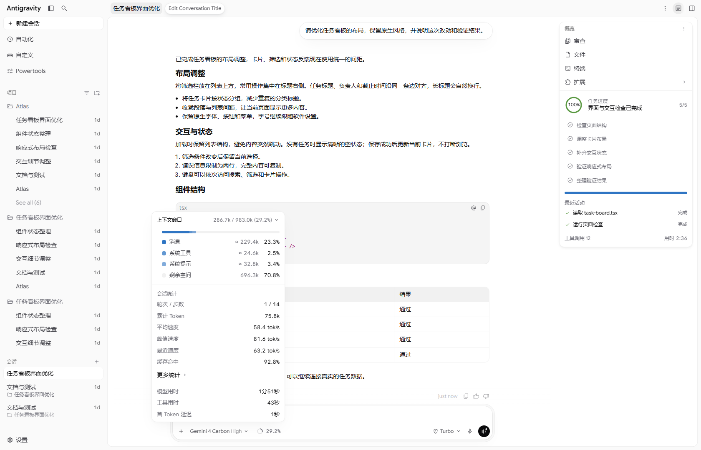

### 上下文统计与任务进度

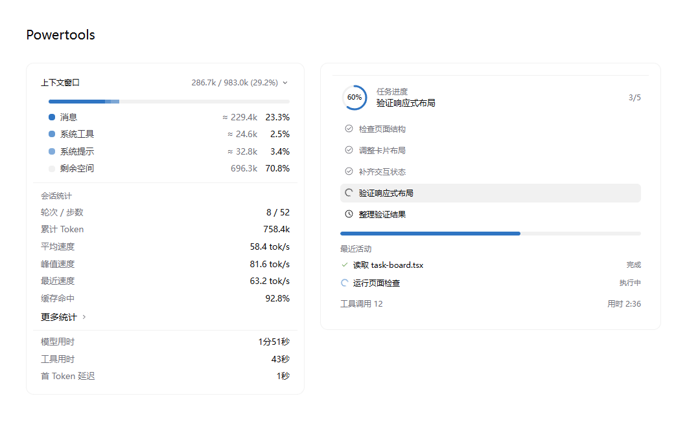

### 用量概览

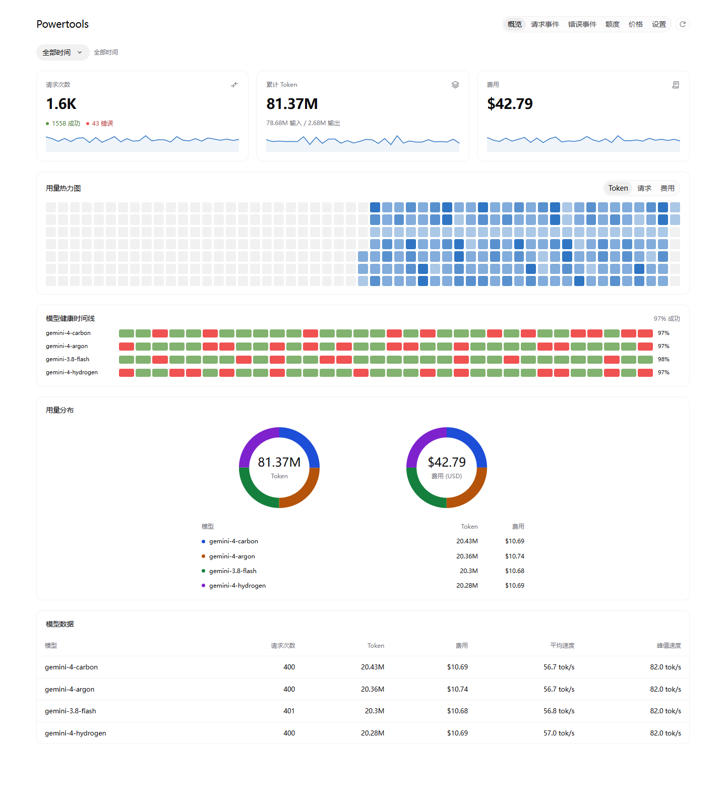

<details>
<summary>查看更多面板截图（请求事件、额度、设置、深色主题与分布图）</summary>

#### 请求事件

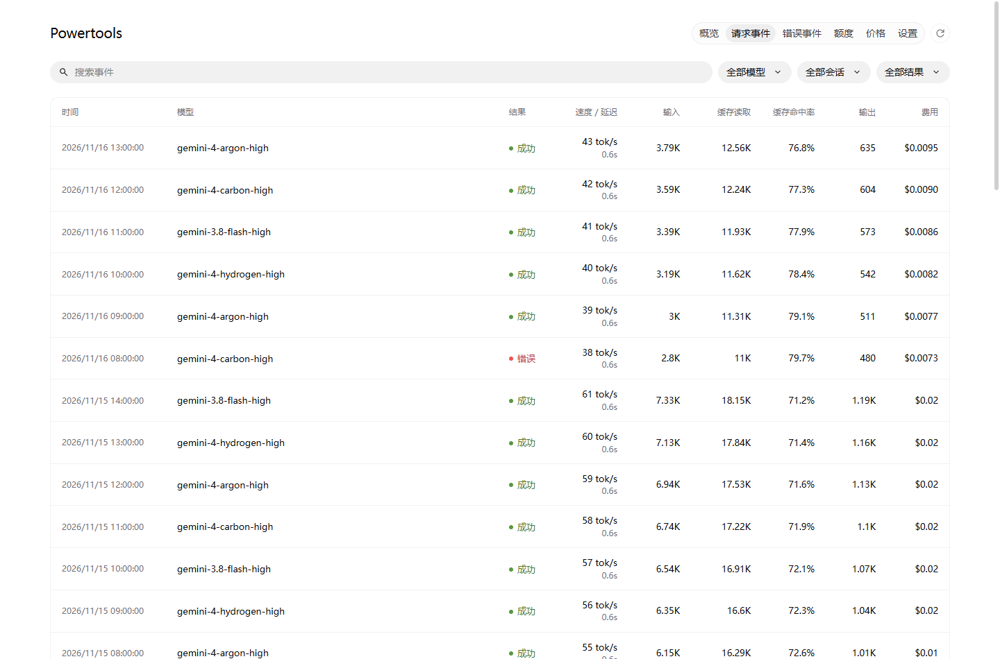

#### 订阅与额度

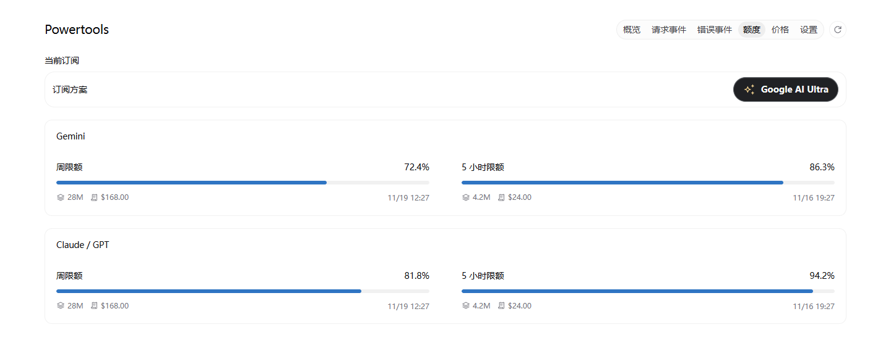

#### 设置

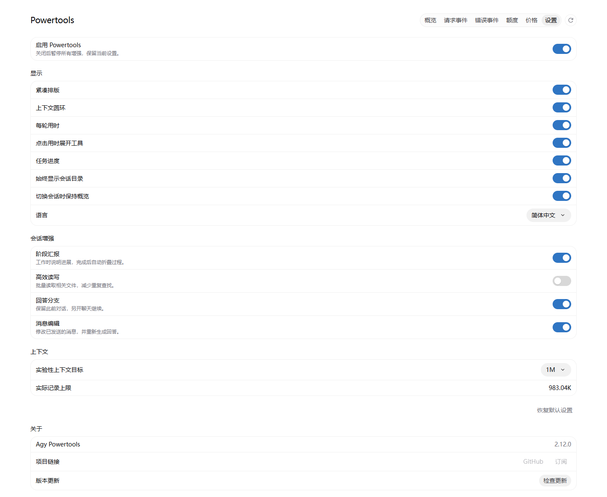

#### 深色概览、用量分布与错误记录

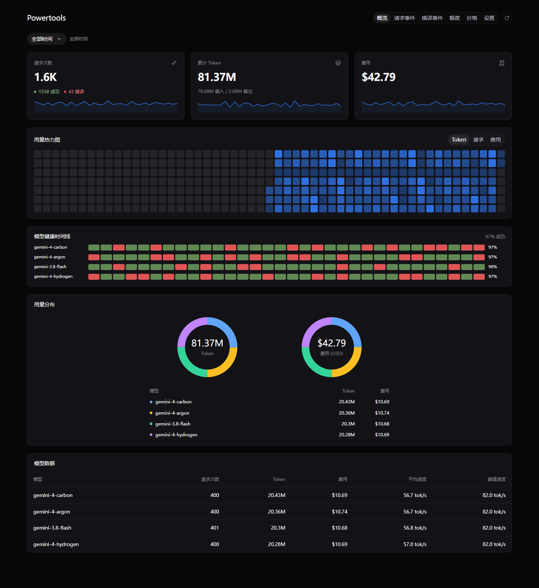

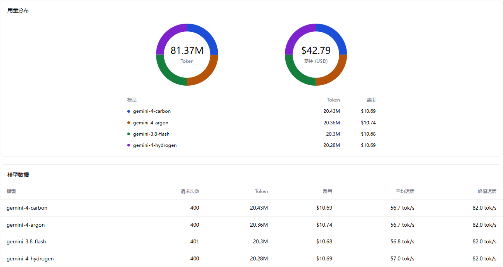

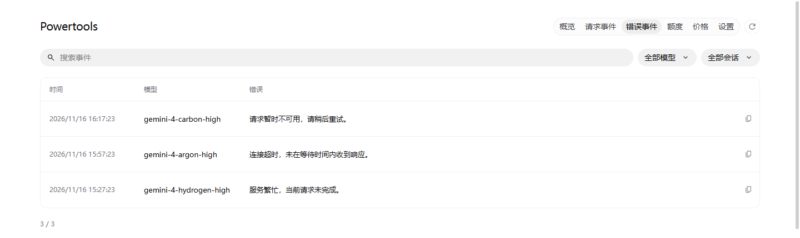

</details>

注：以上截图均使用匿名演示数据生成。

## 更新与卸载

### 检查更新

在 **Powertools -> 设置 -> 关于** 点击 **检查更新**。检测到带完整校验文件的正式版本后，界面会提供 **立即更新**。

更新器在校验通过后自动备份旧版、替换文件并确认新版本正常接入界面，失败时自动恢复旧版。不会后台静默安装，也不会退出 Antigravity。

### 卸载

在项目目录运行对应脚本：

Windows（PowerShell）：

```powershell
powershell -NoProfile -ExecutionPolicy Bypass -File .\uninstall.ps1
```

macOS 和 Linux：

```sh
sh ./uninstall.sh
```

也可执行 `node scripts/uninstall.mjs`。卸载默认清理插件程序、注册项、个人设置、缓存、插件日志、Sidecar 数据和已登记备份；如需保留个人设置，在命令后追加 `--keep-settings`。

原生聊天记录、账户信息、其他插件、工作区文件、下载的源码目录及主动导出的文件均会保留；无法确认归属的历史文件会保留并在终端报告。

## 数据与隐私

- 会话数据库与 JSONL 记录均以只读方式读取，统计与界面注入仅通过本机回环地址完成。
- 无云端统计上报。仅在手动点击“检查更新”时访问 GitHub，在点击“查询价格”时访问官方公开定价页面。
- 插件程序位于 `~/.gemini/config/plugins/agy-powertools/`，设置与缓存位于 `~/.gemini/antigravity/plugin_data/agy-powertools/`。
- 会话分支与消息编辑调用 Antigravity 原生接口。编辑并重发会改写该条消息之后的对话历史，工作区内的本地文件不会随之回滚。
- 未启用后台自动缓存续期。面板中的费用与总额度为参考估算值，不代表实际订阅账单；缺少可靠单价或容量记录时统一显示 `-`。

## 常见问题

**客户端升级后插件入口消失怎么办？**

完成手头任务后重新打开客户端，插件会自动重新发现调试端点和原生组件。若仍未恢复，重新执行一次安装脚本即可。客户端内部结构大幅变动时可能需要等待插件版本适配。

**订阅可以区分 Pro、Ultra、Ultra 5x 和 Ultra 20x 吗？**

仅按原生接口明确返回的身份标识显示。接口未返回倍率时只显示 Ultra，不根据价格或用量猜测。

**开启紧凑排版后怎么调字号？**

直接在 Antigravity 自带设置中调整文字大小。插件的紧凑排版只收紧行高和间距，不覆盖字号。

**使用独立的客户端配置目录怎么办？**

设置环境变量 `ANTIGRAVITY_USER_DATA_DIR`，或通过 `ANTIGRAVITY_CDP_PORT_FILE` 直接指定 `DevToolsActivePort` 文件路径。插件程序与个人设置仍保存在默认目录。
