<div align="center">
  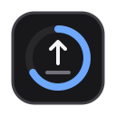
  <h1>Agy Powertools</h1>
  <p><strong>Native UI enhancement plugin for Antigravity 2.0</strong></p>
  <p>
    <a href="https://github.com/WhiteBr1ck/agy-powertools/releases"></a>
    <a href="https://github.com/WhiteBr1ck/agy-powertools/actions/workflows/ci.yml"></a>
    <a href="LICENSE"></a>
    
    = 22.13" />
    
  </p>
  <p>
    <a href="README.md">简体中文</a> |
    <strong>English</strong>
  </p>
  <p>
    <a href="#features">Features</a> |
    <a href="#installation-and-uninstallation">Installation</a> |
    <a href="#key-features-in-detail">Key features</a> |
    <a href="#screenshots">Screenshots</a> |
    <a href="#configuration-reference">Configuration</a> |
    <a href="#changelog">Changelog</a>
  </p>
</div>

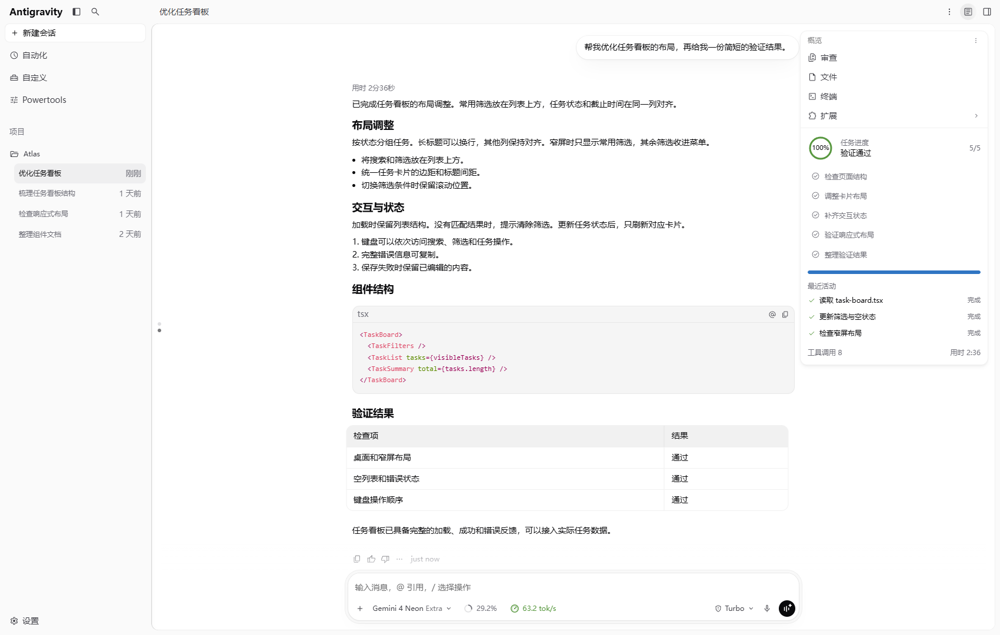

## What it does

**Agy Powertools** is a native UI enhancement plugin for Antigravity 2.0. It attaches directly to the desktop client over the local debugging interface and reads local SQLite and JSONL session records in read-only mode. It does not patch client binaries or open external web dashboards; every control renders inside the native Antigravity interface.

It addresses four common friction points in daily Antigravity usage:

1. **Low reading density and missing localization**: Default chat line height and block spacing leave too little code and tool output on screen, and built-in menus lack Simplified Chinese localization.
2. **Opaque or noisy multi-step execution**: During long tool runs, the agent either stays silent for minutes or leaves intermediate commentary scattered across the main reply.
3. **No live context window or quota visibility**: Long sessions lack a live view of context usage, cache hit rate, token speed, error details, and 5-hour or weekly quota consumption.
4. **Awkward branching and prompt editing**: Retrying a previous prompt with edits or branching a new chat from a specific historical reply takes extra manual steps.

## Features

- **Codex-like conversation flow**: Same-font compact layout, plus live stage updates while tools run that automatically fold into the top duration bar once the turn completes.
- **Live context and session telemetry**: A context ring next to the model selector shows category usage, cache hit rate, average and peak speed, time to first token, and model vs. tool time.
- **Lossless session branching and message editing**: Fork a new chat from any historical reply with full prior steps and tool records preserved, or edit a sent message in place and regenerate.
- **Task progress and persistent turn outline**: Track checklist completion, recent tool activity, and elapsed time in the right Overview panel while keeping the left turn outline visible.
- **Bilingual UI (`English` / `简体中文`)**: Switch between English and Simplified Chinese across Powertools panels and common native Antigravity menus and settings without first-paint flicker.
- **Local usage, error, and quota dashboard**: A dedicated `Powertools` sidebar page with a 53-week usage heatmap, model health timeline, token and cost donuts, request filters, one-click error copy, quota bars, and official API reference pricing.
- **Session enhancements and verified updates**: Optional experimental context targets (`Default` / `256K` / `500K` / `1M`), optional Parallel search & read guidance, and SHA-256 verified in-app updates with automatic rollback on startup failure.

## Installation and uninstallation

### Requirements

- Install and launch Antigravity at least once first.
- Release packages already include prebuilt assets. Installation requires neither `npm install` nor administrator privileges; the installer uses Node.js `>= 22.13` when available and falls back to Antigravity's bundled `agy-node`.

### Install

#### Option 1: Let an Agent install it automatically (recommended)

Send the following prompt to Antigravity or another local coding agent:

> Please install Agy Powertools from https://github.com/WhiteBr1ck/agy-powertools . Read README_EN.md and docs/INSTALL_AGENT.md first, and run the unified installer provided by the project using local Node.js or Antigravity's bundled runtime. Keep all other plugins, account settings, and chat history intact, and do not force-close the running client. Verify the installed version afterward and remind me if a client restart is needed.

#### Option 2: Command-line installation

Download and extract the latest ZIP from [Releases](https://github.com/WhiteBr1ck/agy-powertools/releases) (or clone this repository), then run the installer from the project directory:

Windows (PowerShell):

```powershell
powershell -NoProfile -ExecutionPolicy Bypass -File .\install.ps1
```

macOS / Linux:

```sh
sh ./install.sh
```

If Node.js `>= 22.13` is already installed, you can also run `node scripts/install.mjs`. The installer never force-closes Antigravity, and reinstalling preserves your saved preferences. Restart Antigravity after finishing your current task; **Powertools** will appear in the left sidebar.

### In-app updates

Open **Powertools -> Settings -> About** and click **Check for updates**. When a verified stable release is available, click **Install update**. The updater verifies the SHA-256 digest, backs up the previous installation, swaps files, and confirms the new runtime attaches cleanly, rolling back automatically if startup fails.

### Uninstall

Run the uninstall script from the project directory to remove plugin files, registrations, caches, and runtime data (your native chat history, account, workspace files, and other plugins remain untouched):

Windows (PowerShell):

```powershell
powershell -NoProfile -ExecutionPolicy Bypass -File .\uninstall.ps1
```

macOS / Linux:

```sh
sh ./uninstall.sh
```

Append `--keep-settings` (for example, `node scripts/uninstall.mjs --keep-settings`) to retain your saved preferences.

## Key features in detail

### 1. Codex-like chat experience: Stage updates + Compact layout

Both **Stage updates** and **Compact layout** are enabled by default:

- **Show progress while working, fold when finished**: Before major tool steps, the model writes one or two short sentences stating current findings and the next action. Once the turn finishes, intermediate updates are automatically moved into the collapsed `Worked for ...` group at the top of the reply alongside tool records, leaving only the final answer visible. Click the turn duration anytime to expand the full process.
- **Same-font compact view**: Font size continues to follow your Antigravity setting. The plugin tightens body line height to `1.4`, unifies block and divider spacing, and reduces minimum tool-row height to `24px` so more code and context fit on one screen.

Side-by-side comparison using identical content, window width, and `14px` font size (about 19% shorter body height in this example):

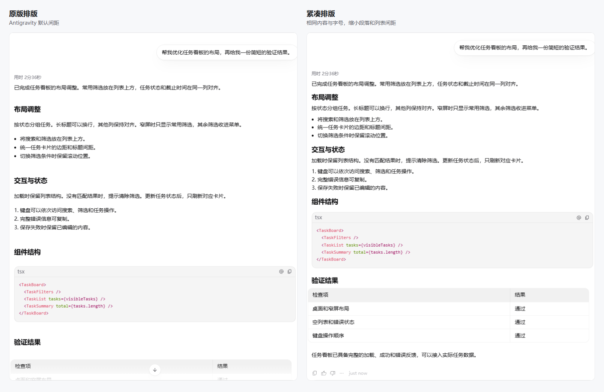

### 2. Context window ring and live session statistics

A compact progress ring sits next to the model selector in the composer. Clicking it opens a native popover with two groups of metrics:

- **Context breakdown**: Actual input token usage from the latest generation, broken down into Messages, System tools, System prompt, and Free space.
- **Session telemetry**: Turn and step counts, total tokens, cache hit rate, estimated 5-minute cache observation window, average / peak / latest generation speed (`tok/s`), time to first token, and cumulative model time vs. tool time.

### 3. Lossless session branching and inline message editing

- **Branch from any reply**: Every completed reply includes a `Branch to new chat` action, and the conversation menu adds `Fork conversation` (also available via `/branch-session`). New branches are automatically renamed with `(1)`, `(2)` suffixes, and conversations that invoked subagents offer a native prompt to branch cleanly from the last turn before the subagent call.
- **In-place native message editing**: Click the edit icon next to any sent user message to mount Antigravity's native rich Lexical composer directly in place, preserving quotes (`Ctrl+L`), `@` mentions, and image attachments while restoring any bottom draft on cancel.

### 4. Local usage, error, and quota dashboard

Click **Powertools** in the left sidebar to open five local analytics tabs:

- **Overview**: Filter by Last 24 hours, Yesterday, This week, This month, Last 30 days, All time, or a custom date range. Includes request success/error counts, input/output tokens, API reference cost, a 53-week usage heatmap, a model health timeline, paired token and cost donut charts, and per-model speed tables.
- **Requests**: Search and filter individual generations by model, conversation scope, and result, with per-request speed, latency, input, cache reads, cache hit rate, output, and estimated cost.
- **Errors**: Inspect failed requests by timestamp, model, and error summary, with one-click copy for the full error message.
- **Quota**: Reads native account quota endpoints to display your current plan badge (Pro / Ultra, etc.) and remaining 5-hour and weekly percentages, reset times, and sampled budget estimates for Gemini and Claude / GPT buckets.
- **Pricing**: Lists per-1M-token input, output, cache read, and cache write rates by model and reasoning effort, with one-click refresh from official Google AI Studio and Google Cloud pricing pages (for reference estimation only, not subscription billing).

### 5. Bilingual interface (`English` / `简体中文`)

Switch between `English` and `简体中文` at any time in **Powertools -> Settings**. Localization runs at initial paint without flicker and strictly excludes chat messages, composer inputs, and code blocks so conversations and source code are never altered.

## Screenshots

### Native shell and context popover

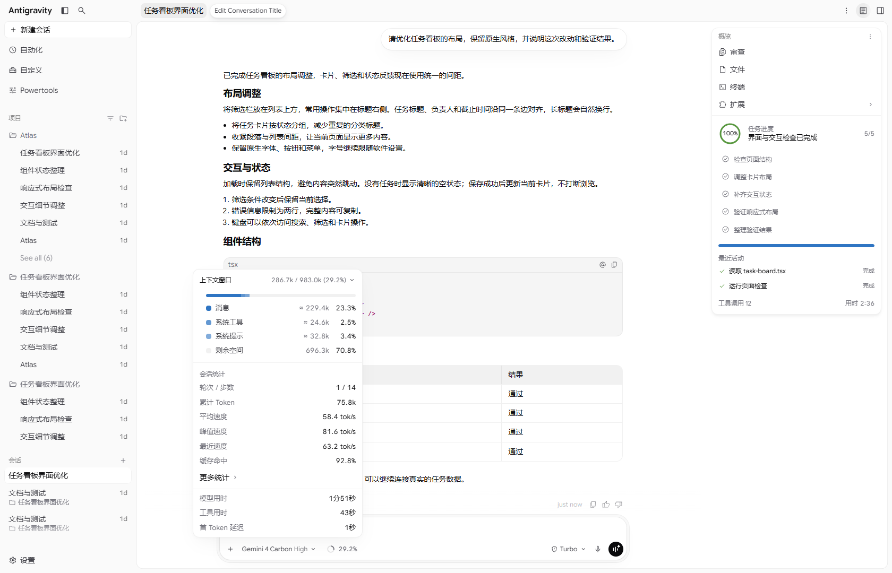

### Context breakdown and task progress

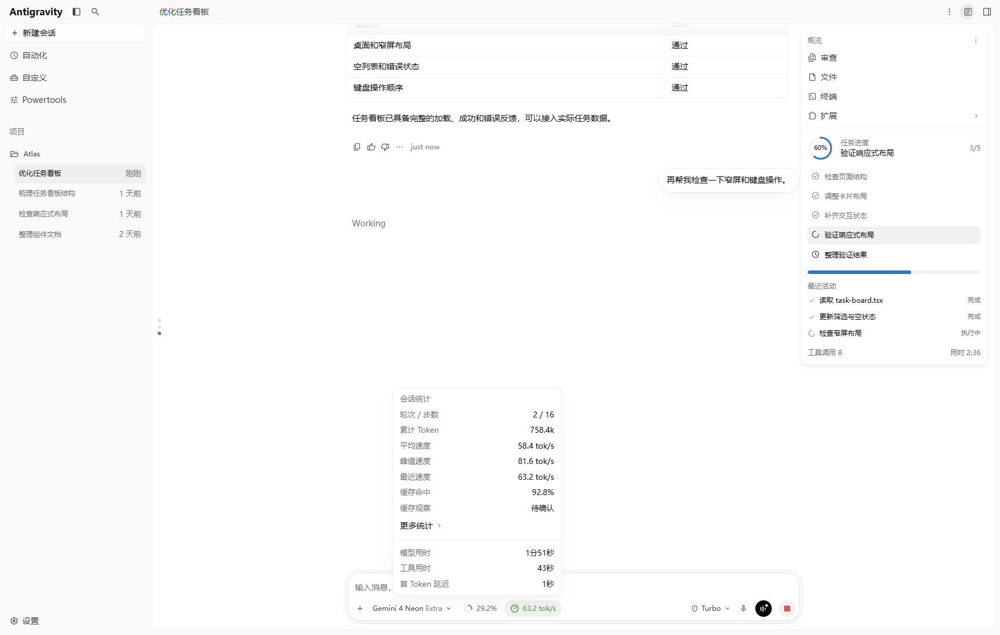

### Usage overview (light and dark themes)

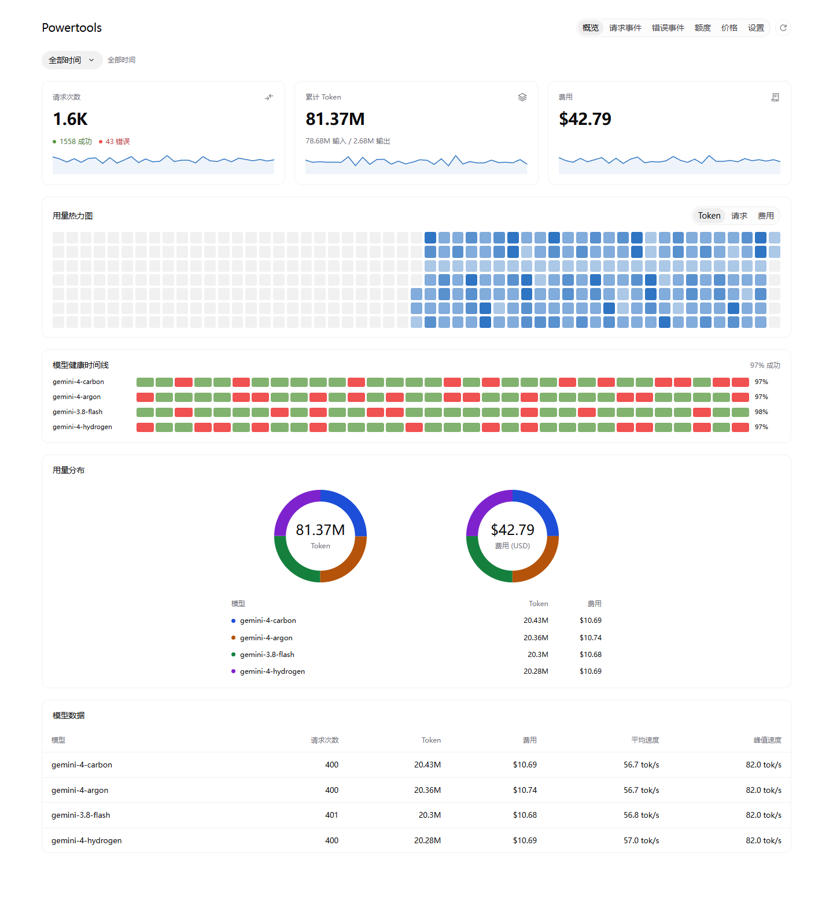

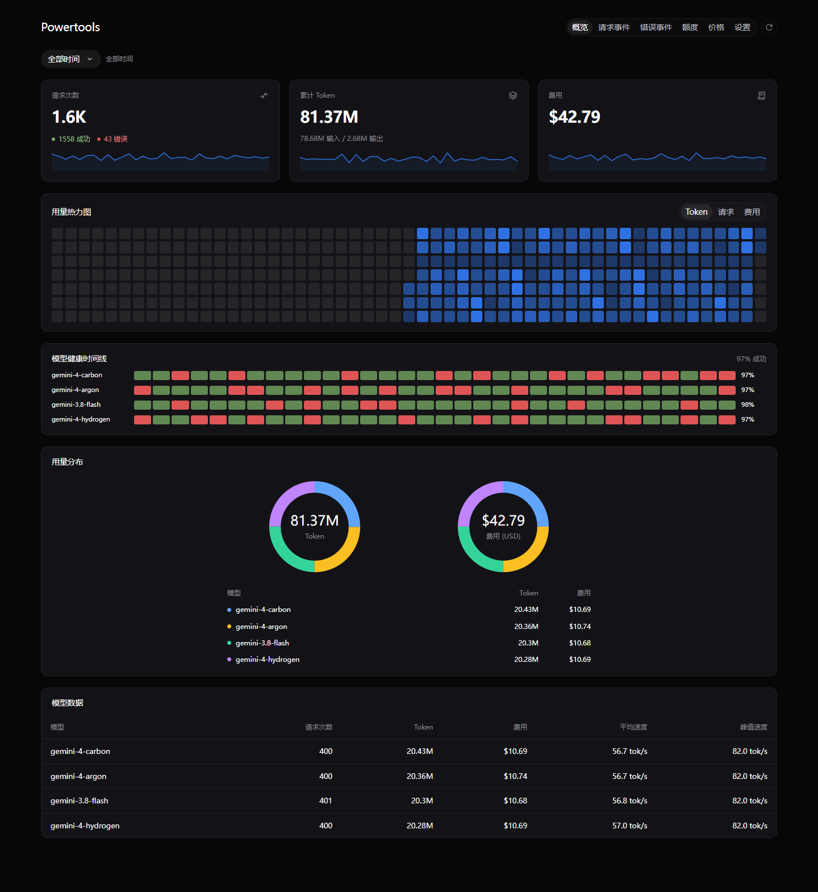

### Request events and quota bars

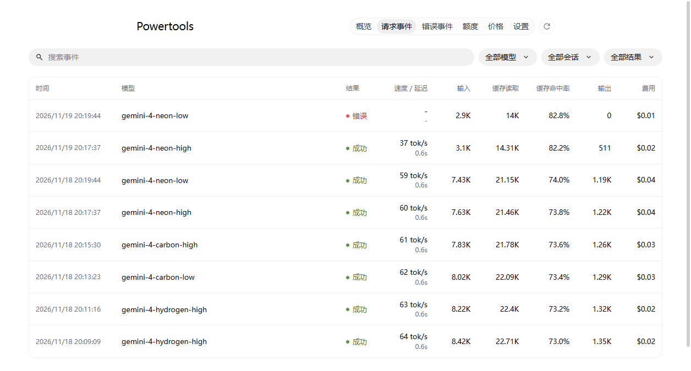

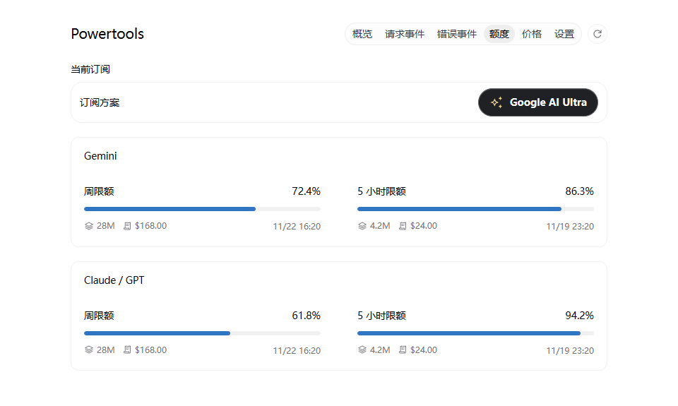

<details>
<summary>More screenshots (usage distribution, error copy, and settings)</summary>

#### Token and cost distribution

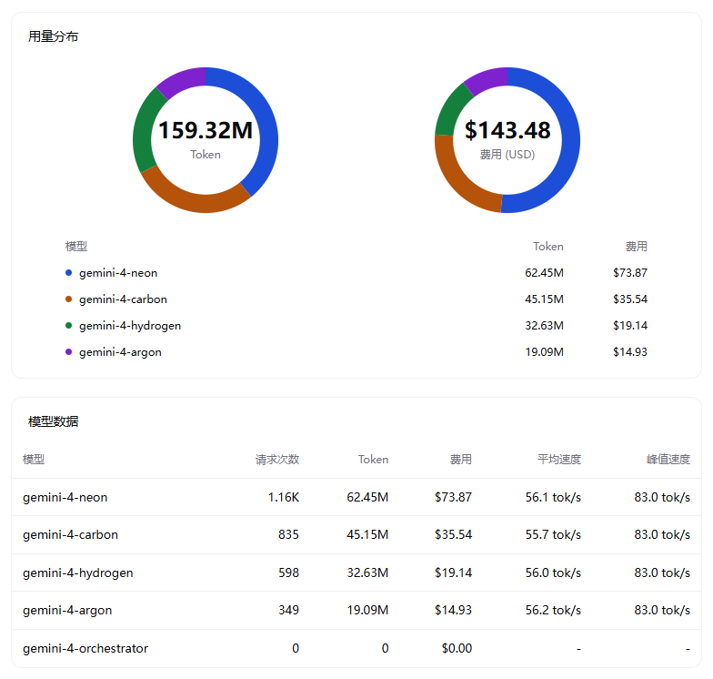

#### Error events and one-click copy

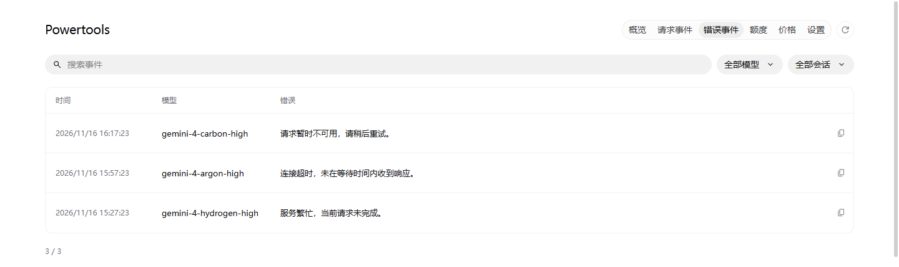

#### Settings and update manager

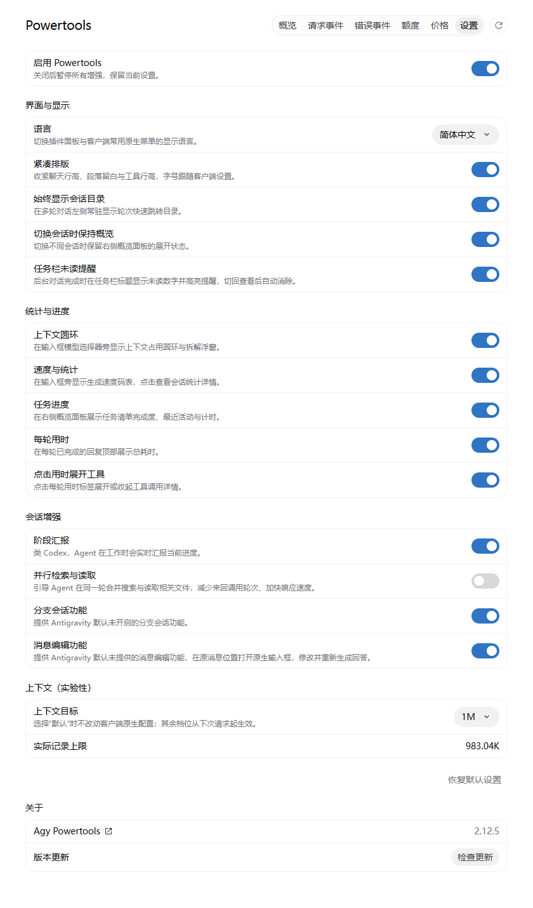

</details>

## Configuration reference

All options can be toggled live in **Powertools -> Settings** and persist automatically (**Restore defaults** is available at the bottom of the page).

### Master switch

| Setting | Default | Description |
| --- | --- | --- |
| Enable Powertools | On | Master switch; turning it off pauses all UI injections and request overrides while keeping your saved preferences |

### Interface & display

| Setting | Default | Description |
| --- | --- | --- |
| Language | `简体中文` | Choose `简体中文` or `English` for Powertools panels and common native client UI menus |
| Compact layout | On | Tightens chat line height and block spacing while following the client font size |
| Always show conversation outline | On | Keeps the turn navigation rail visible in multi-turn chats even when Overview reserves space |
| Keep Overview open when switching chats | On | Preserves the open state of the right Overview panel across chats |

### Telemetry & progress

| Setting | Default | Description |
| --- | --- | --- |
| Context ring | On | Shows the context usage ring and statistics popover in the composer (displays only the ring icon at 0 usage) |
| Task progress | On | Renders checklist progress, recent tool activity, and elapsed timer inside Overview |
| Turn duration | On | Displays completion duration at the top of each finished turn |
| Expand tools from duration | On | Click the turn duration label to expand or collapse tool calls and stage updates |

### Conversation enhancements

| Setting | Default | Description |
| --- | --- | --- |
| Stage updates | On | Codex-style live progress updates while the agent works, folded automatically on completion |
| Parallel search & read | Off | Guides the agent to batch file searches and reads in the same turn to reduce round trips |
| Conversation branching | On | Enables Antigravity's native conversation branching from menus and replies, with automatic `(1)` naming and pre-subagent fallback |
| Message editing | On | Enables native in-place message editing with full support for quotes, `@` mentions, and images |

### Context (Experimental)

| Setting | Default | Description |
| --- | --- | --- |
| Context target | `Default` | Choose `Default`, `256K`, `500K`, or `1M`. `Default` leaves Antigravity's native context configuration untouched; other options set the compaction threshold and token cap starting from the next request (`Observed limit` is shown below) |

### Environment variables and storage paths

| Name / Path | Description |
| --- | --- |
| `ANTIGRAVITY_USER_DATA_DIR` | Custom Antigravity user-data directory when running an isolated client profile |
| `ANTIGRAVITY_CDP_PORT_FILE` | Explicit path to the client `DevToolsActivePort` file (also honors `AGY_BROWSER_ACTIVE_PORT_FILE`) |
| `~/.gemini/config/plugins/agy-powertools/` | Installed plugin program and runtime scripts |
| `~/.gemini/antigravity/plugin_data/agy-powertools/` | User preferences (`settings.json`), component cache, and official pricing cache |

## Changelog

### v2.12.3
- **Antigravity 2.33.0 compatibility**: Automatic cross-platform shortcut launch flag management with clean uninstall restore, background self-healing across client updates, and a one-click restart helper.
- **In-place native rich message editing**: Relocates the native Lexical composer directly to the edited message with full support for selection quotes (`Ctrl+L`), `@` mentions, image attachments, and draft restoration on cancel.
- **Improved conversation branching**: Automatically renames forked conversations with `(1)`, `(2)` suffixes and offers a native modal to branch from the last turn before a subagent invocation.
- **UI & quota refinements**: Redesigned the context popover with Claude Desktop-inspired multi-color segments and aligned columns (ring-only when usage is 0); narrowed Settings to match official readability with a fixed non-jumping header bar while keeping wide tables on Requests and Errors; updated 100% quota estimation to reconcile full-cycle usage from the exact reset start timestamp.

### v2.12.2
- Restored smooth native Overview panel open/close transitions when `Always show conversation outline` is enabled.
- Renamed the context settings group to `Context (Experimental)` and added a `Default` option that leaves Antigravity's native context settings untouched.
- Added missing Simplified Chinese translations for the selection quote popup, composer permissions menu, and Overview section headers, and linked the project name in `About` directly to GitHub.

### v2.12.1
- Improved task progress lifecycle detection using native execution snapshots to accurately distinguish running, stopping, stopped, and terminal error states across upstream retries.

### v2.12.0
- Added in-app update checking and SHA-256 verified installation with an independent worker process, health confirmation, and automatic rollback on failure.
- Added safe in-place file replacement fallback for occupied Windows runtime directories.

### v2.11.0
- Added component declaration caching for faster startup and reload recovery.
- Redesigned paired token and cost distribution donuts in Overview and added the `About` section in Settings.

### v2.10.0
- Adapted component discovery and dynamic endpoint reconnection for Antigravity 2.32.x.
- Added the `Enable Powertools` master switch and reorganized `Conversation enhancements` settings.

## Feedback and license

- **License**: Released under the [MIT License](LICENSE).
- **Issues**: If the sidebar entry disappears or UI components break after an Antigravity client update, please open an issue on [GitHub Issues](https://github.com/WhiteBr1ck/agy-powertools/issues) with your OS, Antigravity version, and Agy Powertools version.
- **Acknowledgements**: The custom date-range calendar interaction in the dashboard is adapted from HextaUI and built with `react-day-picker` and `date-fns`. Third-party license notices are in [lib/vendor/NOTICE.txt](lib/vendor/NOTICE.txt).
