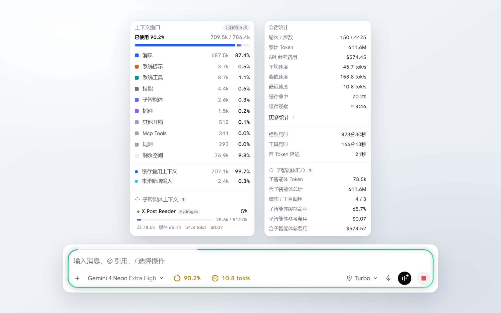
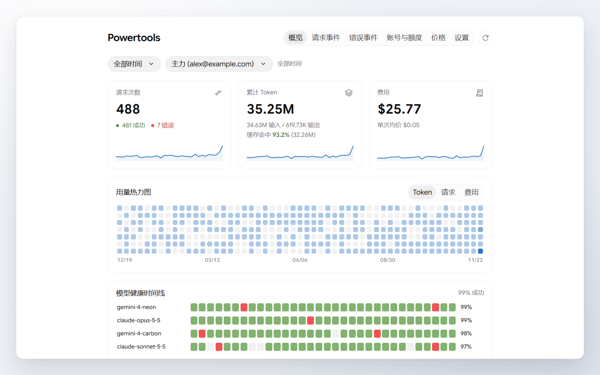
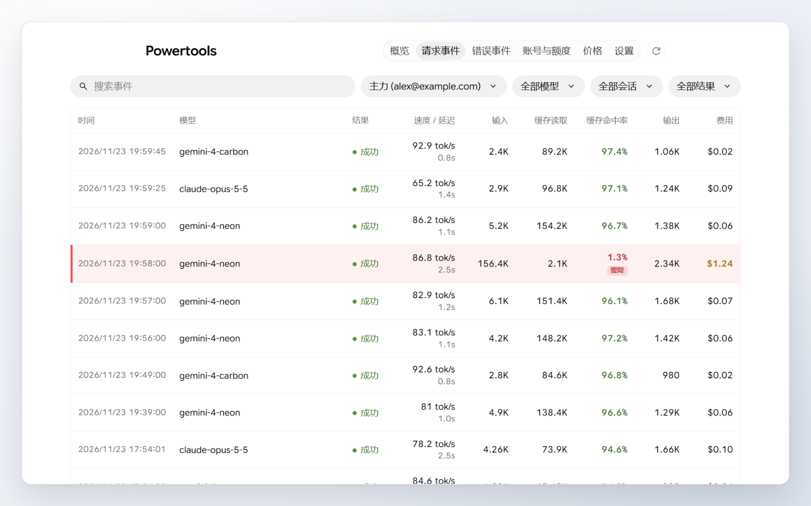
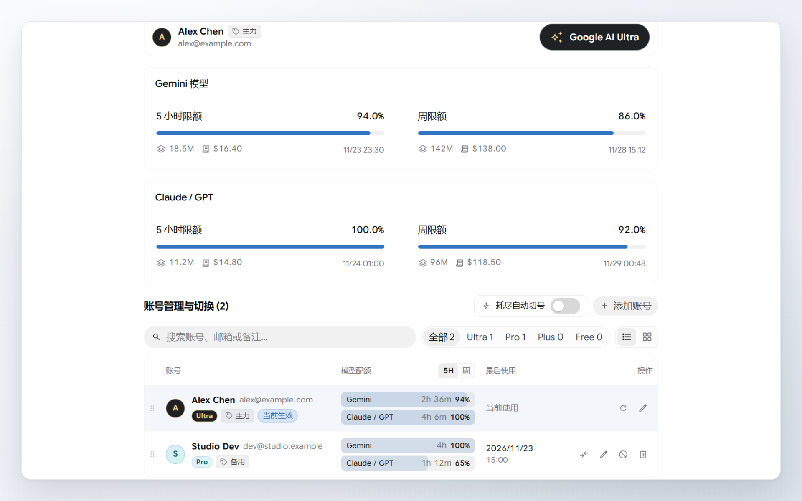

<div align="center">
  
  <h1>Agy Powertools</h1>
  <p><strong>Zero-patch native enhancement plugin for Antigravity 2.0</strong></p>
  <p>Live telemetry, quota halo, lossless branching, multi-account switching, no-TUN proxy, and WSL2 / SSH support</p>
  <!-- plugin-badges:start -->
  <p>
    <a href="https://github.com/WhiteBr1ck/agy-powertools/releases"></a>
    <a href="https://github.com/WhiteBr1ck/agy-powertools/actions/workflows/ci.yml"></a>
    <a href="LICENSE"></a>
    
    = 22.13" />
    
  </p>
  <!-- plugin-badges:end -->
  <p>
    <a href="README.md">简体中文</a> |
    <strong>English</strong>
  </p>
  <p>
    <a href="#showcase">Showcase</a> |
    <a href="#highlights">Highlights</a> |
    <a href="#quick-start">Quick Start</a> |
    <a href="#configuration">Configuration</a> |
    <a href="#changelog">Changelog</a>
  </p>
</div>

<p align="center">
  
</p>

> **Agy Powertools** attaches to Antigravity 2.0 over the local debugging interface and reads local SQLite and JSONL session logs in read-only mode. **No `app.asar` patches, no external browser tabs, and zero telemetry sent off-device** — every control renders natively inside the desktop app.

---

## Showcase

<table>
  <tr>
    <th width="50%">Composer Quota Halo, Context Ring &amp; Speed Dial</th>
    <th width="50%">Collapsible Overview Panels &amp; File Context Menu</th>
  </tr>
  <tr>
    <td>
      
      <p>Clockwise emerald/amber/red perimeter quota halo (Auto, Weekly, or 5h), paired with independent context breakdown (including Orchestrator models) and a live speedometer.</p>
    </td>
    <td>
      
      <p>Native-style collapsible Task Progress (live phase + connected timeline) and equal-width Quota pills, plus right-click file actions (local, Files tree, and LAN NAS) and user bubble tinting.</p>
    </td>
  </tr>
  <tr>
    <th>Usage Overview (Light: Heatmap &amp; Model Health)</th>
    <th>Usage Overview (Dark: Donuts &amp; Model Stats)</th>
  </tr>
  <tr>
    <td>
      
      <p>Defaults to the active weekly quota reset cycle, summarizing requests, input/output tokens, overall cache hit rate, reference cost, 53-week heatmap, and model health timeline.</p>
    </td>
    <td>
      
      <p>Adapts seamlessly to light and dark themes with paired token and cost donut charts plus per-model cache hit rate and throughput tables.</p>
    </td>
  </tr>
  <tr>
    <th>Requests Log &amp; Cache Anomaly Detection</th>
    <th>Multi-Account Switching &amp; Quota Manager (Opt-in)</th>
  </tr>
  <tr>
    <td>
      
      <p>Filter generations by account, model, conversation, or outcome; highlights genuine short-interval cache drops and wipes while filtering out cold starts and compactions.</p>
    </td>
    <td>
      
      <p>Isolates multiple Google accounts via OS native keyrings without plaintext tokens, featuring a sidebar switcher, list/card layouts, drag reordering, and optional auto-switch.</p>
    </td>
  </tr>
  <tr>
    <th>Multilingual UI, Bubble Tint &amp; Halo Settings</th>
    <th>No-TUN Proxy &amp; Markdown Release Notes</th>
  </tr>
  <tr>
    <td>
      
      <p>Flicker-free English, Simplified Chinese, and Traditional Chinese switching across native menus and Swarm iframes, plus restrained bubble tint presets and halo window controls.</p>
    </td>
    <td>
      
      <p>App-only proxy injection without patching binaries or shortcuts, complete with HTTP CONNECT / SOCKS5 checks, Force HTTP/1.1, and safe Markdown rendering for in-app update notes.</p>
    </td>
  </tr>
</table>

---

## Highlights

### Chat Flow & Ergonomics
- **Codex-like pacing and compact layout**: Preserves your chosen client font size while tightening line height (`1.4`) and block spacing (~19% shorter body height); streams brief live stage updates during multi-step runs and folds them into the top duration header on completion.
- **Lossless conversation branching and in-place editing**: Fork from any historical reply or conversation menu via native `ForkConversation` (including conversations with subagents and automatic `(1)` / `(2)` naming), or mount Antigravity's native Lexical editor directly in place to revise and regenerate.
- **Native file context menu (local, Files tree, and LAN NAS)**: Right-click `file://` links or Files tree entries to attach images/files to chat, open with the default app, reveal in folder, copy the file, or copy its path; on Windows, DNS-verified non-global IP checks support LAN NAS / SMB UNC paths and `wsl.localhost` while blocking public SMB servers against NTLM leaks.
- **Flicker-free multilingual UI**: Switch between English, Simplified Chinese, and Traditional Chinese across Powertools, Antigravity native menus, permission dialogs, and Swarm iframes while keeping conversation text and code untouched.

### Telemetry, Quotas & Dashboard
- **Composer telemetry and clockwise quota halo**: Dedicated Context Ring (with step cache reuse, compaction counter, and Orchestrator planner/executor breakdown), Dynamic Speedometer (`tok/s`, TTFT, model vs. tool timing, and session cost), and optional clockwise perimeter quota halo (Auto / Weekly / 5h).
- **Collapsible right Overview panels**: Native-style collapsible `Task progress` (live phase, vertical connected timeline, per-step durations, live timer) and optional `Quota` (equal-width 5h/weekly pills) with compact status/minimum-quota badges when collapsed.
- **Local Powertools analytics**: Five built-in views (`Overview`, `Requests`, `Errors`, `Quota`, and `Pricing`) with weekly-reset alignment, short-interval cache anomaly detection, multi-device incremental weekly quota calibration, subagent aggregation, and live official API pricing refresh.

### Cross-Environment & Power Features
- **Windows Antigravity + WSL2 backend support**: Automatically detects WSL2 and locates Windows `%APPDATA%\Antigravity\DevToolsActivePort`, using direct loopback in Mirrored mode and a persistent multiplexed TCP-over-stdio bridge in default NAT mode, paired with a hybrid WSL2 credential vault (atomic `0600` files + isolated Windows Credential Manager backup slots) and Windows relaunch delegation.
- **OpenSSH remote window telemetry**: Runs an on-demand, zero-disk-footprint read-only worker over local OpenSSH for `SSH: ...` windows, syncing context, speed, subagent, and dashboard metrics without installing anything on the remote host.
- **Opt-in multi-account switching and no-TUN proxy**: Both disabled by default; multi-account uses OS keyrings (Windows Credential Manager, macOS Keychain, Linux Secret Service) and the application proxy injects Chromium flags and env vars on relaunch with connectivity testing and `GODEBUG=http2client=0`.

---

## Quick Start

> Requirements: Antigravity installed and launched at least once. Uses local Node.js `>= 22.13` or falls back to Antigravity's bundled `agy-node`; no `npm install` or administrator privileges required.

### Option 1: Let an Agent install it (recommended)

Send this prompt to Antigravity or another local coding agent:

> Please install Agy Powertools from https://github.com/WhiteBr1ck/agy-powertools . Read README_EN.md and docs/INSTALL_AGENT.md first, and run the unified installer provided by the project using local Node.js or Antigravity's bundled runtime. Keep all other plugins, account settings, and chat history intact, and do not force-close the running client. Verify the installed version afterward and remind me if a client restart is needed.

See [Agent installation guide](docs/INSTALL_AGENT.md) for details.

### Option 2: Command-line install

Download and extract the latest ZIP from [Releases](https://github.com/WhiteBr1ck/agy-powertools/releases) (or clone this repo), then run:

```powershell
# Windows (PowerShell)
powershell -NoProfile -ExecutionPolicy Bypass -File .\install.ps1
```

```sh
# macOS / Linux / WSL2
sh ./install.sh
```

Reinstalling preserves all saved preferences without force-closing Antigravity. Restart once after finishing your current task; **Powertools** appears in the left sidebar. On macOS, a native-icon launcher is created in `~/Applications/` for easy Dock replacement.

### In-app updates and uninstall

- **In-app updates**: Open **Powertools -> Settings -> About -> Check for updates** and click **Install update** for SHA-256 verified installation with automatic rollback on failure.
- **Uninstall**: Run `powershell -NoProfile -ExecutionPolicy Bypass -File .\uninstall.ps1` (Windows) or `sh ./uninstall.sh` (macOS / Linux / WSL2). Append `--keep-settings` to preserve preferences. Native chats, accounts, and other plugins are never touched.

---

## Configuration

Every option toggles live in **Powertools -> Settings** and persists automatically (**Restore defaults** is at the bottom).

<details>
<summary><strong>Expand full configuration table, environment variables, and storage paths</strong></summary>

### Interface & display

| Setting | Default | Description |
| --- | --- | --- |
| Enable Powertools | On | Master switch; pauses all UI injections and overrides while keeping saved settings |
| Language | `简体中文` | Switch between `简体中文`, `繁體中文`, and `English` across Powertools and native UI |
| Compact layout | On | Tightens body line height (`1.4`), block spacing, and tool rows while keeping client font size |
| Tint user message bubbles | Off | Adds a restrained low-saturation fill and hairline border (Accent, 5 presets, or custom color) |
| Always show conversation outline | On | Keeps the left turn navigation rail visible in multi-turn chats |
| Keep Overview open when switching chats | On | Preserves the right Overview panel open state across conversations |
| Conversations per project | `Default (6)` | Controls per-project visible chats in the sidebar (`Default (6)`, `1-10`, or `Show all`) |
| Taskbar unread badge | On | Shows `(N)` unread count in the window and taskbar title when background chats finish |

### Telemetry & progress

| Setting | Default | Description |
| --- | --- | --- |
| Default Overview range | `Current weekly quota` | Choose weekly quota window, Today, 24h, Yesterday, This week, This month, 30d, or All time |
| Context ring | On | Shows composer context usage ring, cache reuse breakdown, and Orchestrator per-model bars |
| Speed & statistics | On | Shows circular dynamic speedometer and session telemetry popover |
| Task progress | On | Collapsible Overview section with checklist progress, live phase, and connected activity trail |
| Show quota in Overview | Off | Collapsible Overview section displaying equal-width 5-hour and weekly remaining quota pills |
| Composer quota halo | Off | Clockwise perimeter quota ring around the composer card (emerald / amber / solid red) |
| Quota halo window | `Auto (lower)` | Choose `Auto (lower)`, `Weekly limit`, or `5-hour limit` when the halo is enabled |
| Subagent context & telemetry | On | Shows per-subagent model, context usage, tokens, cache hit rate, speed, and cost |
| Turn duration / Expand tools | On | Shows total duration on finished replies and expands tool calls and stage updates on click |

### Enhancements, Accounts, Proxy & Experimental Context

| Setting | Default | Description |
| --- | --- | --- |
| Stage updates | On | Codex-style live progress updates while working, automatically folded on completion |
| Parallel search & read | Off | Guides the agent to batch file searches and reads in the same turn |
| Branching / Message edit / File menu | On | Native lossless branching, in-place Lexical editing, and local/NAS/Files tree context menu |
| Enable multi-account switching | Off | Opt-in with risk notice; sidebar switcher, list/card views, 5H/weekly toggle, and auto-switch |
| Application proxy (no TUN) | Off | Split protocol/host/port fields, connectivity checks, cold-start prompt, and Force HTTP/1.1 |
| Context target (Experimental) | `Default` | Choose `Default`, `256K`, `500K`, or `1M` (`Default` leaves native settings untouched) |

### Environment variables & paths

| Name / Path | Description |
| --- | --- |
| `ANTIGRAVITY_USER_DATA_DIR` | Custom Antigravity user-data directory for isolated profiles |
| `ANTIGRAVITY_CDP_PORT_FILE` | Explicit path to `DevToolsActivePort` (also honors `AGY_BROWSER_ACTIVE_PORT_FILE`) |
| `~/.gemini/config/plugins/agy-powertools/` | Installed plugin files and runtime scripts |
| `~/.gemini/antigravity/plugin_data/agy-powertools/` | Preferences, account metadata, quota samples, and official pricing cache |

</details>

---

## Changelog

### v2.14.0
- **Native support for Windows Antigravity + WSL2 backend mode (#21, thanks `@Hopeless` for the architecture design and real-machine verification)**:
  - **WSL2 detection and zero-config NAT/Mirrored CDP bridge**: Automatically resolves Windows `%APPDATA%\Antigravity\DevToolsActivePort` via WSL Interop; tries direct loopback first (Mirrored mode) and falls back automatically to a persistent Windows `node.exe` / `agy-node.exe` multiplexed TCP-over-stdio bridge in default NAT mode with page-context component discovery, requiring no `.wslconfig` or TUN routing changes.
  - **WSL2 hybrid multi-account vault and runtime capability probing**: Added `vault.probe()` with explicit error reporting for headless Linux without `secret-tool` / Secret Service; in WSL2, reads/writes `~/.gemini/jetski-standalone-oauth-token` and `~/.config/antigravity/credential-user-scope` atomically (`0600`) while storing encrypted backup slots in Windows Credential Manager via stdin + `WSLENV` under an isolated `agy-powertools:wsl:<distro>:account:<id>` namespace.
  - **Windows shortcut & relaunch delegation with graceful fallback**: Delegates `.lnk` maintenance, post-update prompts, and `Antigravity.exe` relaunches to Windows `powershell.exe` from WSL2; if automatic relaunch fails after switching credentials, surfaces `manualRestartRequired` cleanly instead of failing the switch; adds a non-login-shell `nvm` hint in the installer when no standard system `node` exists, and prunes dead-PID runtime JSON records on sidecar startup.

### v2.13.9
- **Added Windows LAN NAS / SMB share (UNC) support for the file context menu**: Separated RFC 8089 `file:` URI parsing (2-slash and 4-slash UNC forms) from network-level verification; verifies literal IPs or resolves hostnames via `dns.lookup` before touching SMB and allows access only when every resolved IP falls within IANA non-global address space (no hardcoded domain suffix list), while continuing to block public hosts against NTLM credential leaks and properly quoting UNC paths with spaces for `explorer.exe /select`.

### v2.13.8
- **Fixed composer quota halo wrapping header bars on New Chat**: Mounted directly on `.surface-composer-card` so project/branch headers above the input box are never outlined.
- **Added `Quota halo window` selector**: Choose between `Auto (lower)`, `Weekly limit`, or `5-hour limit`.
- **Fixed Release notes Markdown rendering in About**: Replaced raw `<pre>` output with a safe pure-React Markdown renderer supporting headings, nested lists, bold text, inline code, horizontal rules, and `https://` links.

### v2.13.7
- **Added opt-in Composer quota halo and Overview quota panel (#18)**: Clockwise emerald/amber/red perimeter quota halo plus native-style collapsible `Task progress` and equal-width `Quota` Overview sections.
- **Incremental checkpoint calibration for multi-device weekly quota estimates (#19)**: Excludes zero-local-request external drops when sharing one account across Mac and Windows.
- **Eliminated AV false positives and redundant hook subprocess spawns (#20)**: Removed hidden Windows PowerShell `FlashWindowEx` calls (pure title `(N)` unread counter) and disabled legacy unused `hooks.json` telemetry hook.
- **Expanded high-frequency native UI translations**: Added sidebar project menu, permission approval options and dynamic rule templates, `Thought Process`, `Thought for Xs`, and `Step X of Y` (Simplified & Traditional Chinese).

<details>
<summary>View earlier changelog history (v2.10.0 - v2.13.6)</summary>

- **v2.13.6**: Streamlined Overview Task Progress with integrated live phase header, connected vertical activity trail, per-step durations, right-anchored live timer, and Orchestrator tooltip translation.
- **v2.13.5**: Added optional User Message Bubble Tint, refined Requests table width, fixed `#` paths in `file://` context menu, and expanded 2.34.0 UI/dialog localizations.
- **v2.13.4**: Added Current weekly quota default Overview range (#12), OpenSSH remote window telemetry (#14), multi-account quota isolation and request filtering (#9, #11), attach images/files to chat from context menu, Swarm iframe localization (#10), and split-pane/edit/polling fixes (#15).
- **v2.13.3**: Added full-history branching for conversations with subagents, macOS native launcher icon and Dock guide (#7, #8), and 2.34.0 menu translations.
- **v2.13.2**: Added cache hit rate metrics and short-interval cache anomaly detection (#6), Traditional Chinese (`zh-TW`), Orchestrator updates, and dynamic Claude pricing parsing.
- **v2.13.1**: Added subagent context & telemetry, live execution phases in Task Progress, Today Overview range, and Aux Pane built-in update fallback.
- **v2.13.0**: Antigravity 2.34.0 compatibility, opt-in multi-account switching, opt-in no-TUN application proxy, edit state suspension, and packaged README badge fix (#5).
- **v2.12.0 - v2.12.10**: In-app verified updater, declaration caching, in-place Lexical message editing, taskbar unread badges, split context/speed popovers, local file context menu (#2), sidebar project limits, and stability fixes (#1, #3, #4).
- **v2.10.0 - v2.11.0**: Antigravity 2.32.x support, paired token/cost donuts, and master switch.

</details>

---

## License & Links

- **License**: [MIT License](LICENSE) (custom date-range calendar adapted from HextaUI using `react-day-picker` and `date-fns`; see [lib/vendor/NOTICE.txt](lib/vendor/NOTICE.txt))
- **Issues**: [GitHub Issues](https://github.com/WhiteBr1ck/agy-powertools/issues) (please include OS, Antigravity version, and plugin version)
- **Community**: [LINUX DO](https://linux.do/)
